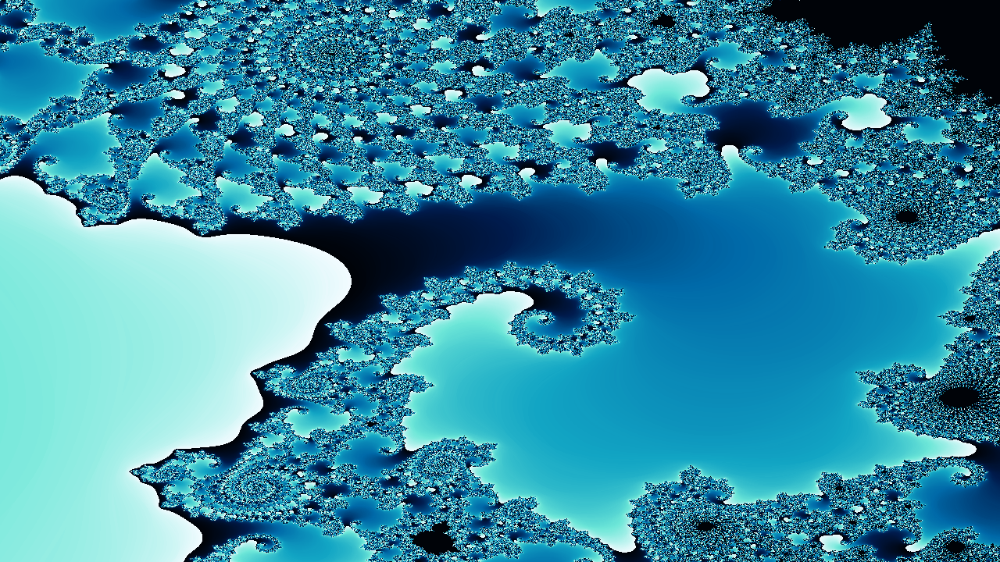

# Mandel Zoom

**Fractal wallpaper and deep-zoom frame renderer, with a SIMD escape-time core
compiled from Mojo and shareable PNGs and GIFs.**

```console
$ python -m mojoapp_mandelzoom still --preset seahorse --width 1280 --height 720 --max-iter 600 -o deep.png
wrote deep.png  512.8 KiB  1280x720  max_iter 600  201.8 ms  2741 Mpix-it/s
```

---

## 30-second quickstart

```bash
pixi run build                     # compile src/ -> dist/libmojoapp-mandelzoom.so
pixi run test                      # 87 tests, incl. parity vs a pure-Python reference
pixi run demo                      # -> demo/out/ (PNG, GIF, text card, JSON)

python -m mojoapp_mandelzoom --help
python -m mojoapp_mandelzoom still --preset seahorse --palette cosmic -o wallpaper.png
python -m mojoapp_mandelzoom zoom  --preset seahorse --frames 20 --factor 1.3 -o deep.gif
python -m mojoapp_mandelzoom card  --preset spiral
python -m mojoapp_mandelzoom stats --preset cusp --width 400 --height 225
python -m mojoapp_mandelzoom presets      # the nine named views and eight palettes
```

Or from Python:

```python
from mojoapp_mandelzoom import Frame, preset, zoom_sequence

f = Frame(1280, 720, max_iter=600)
rgb, idx = f.render(preset("seahorse"), "cosmic")   # idx is palette-indexed
```

There is **no RNG in the render path**. Every artifact is a pure function of
the view, the size, the iteration cap and the palette, so `pixi run demo`
reproduces `demo/out/` byte for byte — `tests/test_golden.py` asserts that.

---

## Example output

Both images below are generated by `demo/make_demo.py`, not drawn by hand.

| artifact | what it is | size |
| --- | --- | ---: |
| [`demo/out/poster.png`](demo/out/poster.png) | 1280x720 seahorse valley wallpaper, 600 iterations | 512.8 KiB |
| [`demo/out/zoom.gif`](demo/out/zoom.gif) | 20-frame deep zoom, 1.3x per frame, **146x** deeper than it starts | 1540.8 KiB |
| [`demo/out/card.txt`](demo/out/card.txt) | terminal text card, double spiral | 4.5 KiB |
| [`demo/out/zoom.json`](demo/out/zoom.json) | the exact view sequence the GIF walks, frame by frame | 3.5 KiB |
| [`demo/out/stats.json`](demo/out/stats.json) | histogram, timings, kernel constants | 1.8 KiB |

<p align="center">
  
  <br>
  <sub>Seahorse valley at half-height 0.0042, <code>cosmic</code> palette, 600 iterations.</sub>
</p>

The zoom GIF descends the same view 20 times at 1.3x per frame. Its iteration
budget climbs with depth (`700 -> 1460`), which is what keeps the deep frames
resolving instead of flattening out. The recipe is published alongside it in
`zoom.json` — same frames, same order, same iteration budget.

---

## Benchmark

`pixi run bench`, measured on the machine that produced
[`bench/last_run.json`](bench/last_run.json): Intel Xeon E5-2697 v4,
72 CPUs available, load average **87.0** at the time of the run (heavily
oversubscribed), Python 3.13.15, NumPy 2.5.3. 2 warm-ups, best of 5, wall time.
Reproduce it; these numbers are not a claim about your hardware.

### compiled Mojo vs pure Python

`speedup` is `reference_seconds / mojo_seconds`, so >1 means Mojo wins.
The **agreement** column is the honest part of this table: escape-time is
chaotic, so the two implementations agree on interior pixels exactly and can
differ on the handful of pixels sitting exactly on the `|z| = 2` boundary.

| case | view | pixels | iters | Mojo | Mpix-it/s | pure Python | speedup | agreement |
| --- | --- | ---: | ---: | ---: | ---: | ---: | ---: | :---: |
| 128x128 x200 | seahorse | 16,384 | 200 | 12.808 ms | 256 | 269.6 ms | 21.0x | exact |
| 256x144 x300 | seahorse | 36,864 | 300 | 15.992 ms | 692 | 722.2 ms | 45.2x | exact |
| 320x240 x200 | full | 76,800 | 200 | 18.880 ms | 814 | 716.8 ms | 38.0x | 99.9583% |
| 480x270 x400 | elephant | 129,600 | 400 | 31.993 ms | 1620 | 2064.2 ms | 64.5x | 99.9992% |
| 640x360 x300 | cusp | 230,400 | 300 | 45.019 ms | 1535 | 386.5 ms | 8.6x | 99.7687% |
| 800x450 x600 | spiral | 360,000 | 600 | 78.990 ms | 2735 | 15198.2 ms | 192.4x | exact |
| 1024x576 x500 | seahorse | 589,824 | 500 | 103.981 ms | 2836 | skipped | — | ~24s > 20s |
| 1920x1080 x800 | full | 2,073,600 | 800 | 474.833 ms | 3494 | skipped | — | ~128s > 20s |
| 16x16 x50 | full | 256 | 50 | 0.312 ms | 41 | 1.1 ms | 3.4x | exact |
| 32x32 x50 | full | 1,024 | 50 | 0.358 ms | 143 | 3.3 ms | 9.4x | exact |
| 64x36 x100 | cusp | 2,304 | 100 | 1.076 ms | 214 | 4.2 ms | 3.9x | 98.4809% |

**Headline: 192.4x** over the pure-Python reference at 800x450 x 600 iterations
(the spiral view, where almost every pixel escapes early). The conservative
figure is the 8.6x–64.5x band across the other timed cases.

The two largest cases are `skipped` rather than estimated. Pure-Python
escape-time at those sizes costs 24s to 128s per run; the benchmark probes a
16x16 frame, scales the per-pixel cost up by pixel count, and refuses to run
anything above a 20s ceiling. It reports `skipped (~Ns > 20s)` — it never
invents a number it did not measure. Note that this ceiling is load-sensitive:
an earlier run of this same table on the same machine had a 24s case finish and
read 61.4x at 480x270 instead of 192.4x here. **Re-run it; treat any single
run as one sample of a busy host.**

No row was slower in this run. That is worth reading against the second table,
because a compiled path *should* lose somewhere.

### serial vs parallel

Whether a `parallelize` launch pays for itself is a property of the machine,
not of the source. Same frame (seahorse valley, 400 iterations), same worker
count.

| shape | pixels | serial ms | parallel ms | parallel speedup | winner |
| --- | ---: | ---: | ---: | ---: | :---: |
| 128x72 | 9,216 | 16.60 | 14.36 | 1.16x | parallel |
| 256x144 | 36,864 | 56.37 | 21.76 | 2.59x | parallel |
| 512x288 | 147,456 | 223.28 | 48.04 | 4.65x | parallel |
| 1024x576 | 589,824 | 889.16 | 96.36 | 9.23x | parallel |
| 1920x1080 | 2,073,600 | 3129.31 | 256.65 | 12.19x | parallel |

The parallel loop won at every size in this run. It does not always: on an
earlier run of this same table, 128x72 came out at **0.86x** — the launch cost
more than the frame — and that row was kept and labelled rather than dropped.
`render.calibrate()` measures the crossover at run time instead of trusting a
constant, so the same code goes parallel on a quiet machine and stays serial on
a busy one. The kernel's hard floor is 32,768 pixels; below it the serial loop
is the only path there is.

---

## How it works

```
src/mandel.mojo           escape-time kernels (SIMD, parallel)
src/capi.mojo             the C ABI: buffers cross as Int addresses
        |  mojo build --emit shared-lib
        v
dist/libmojoapp-mandelzoom.so
        |  ctypes
        v
python/mojoapp_mandelzoom/   views, zoom sequences, palettes, PNG/GIF, CLI
```

**The algorithm.** For each pixel, iterate `z <- z*z + c` from `z = 0` until
`|z|² > 4` or `max_iter`. The escape value is the smooth iteration count
`mu = (hit+1) - log2(0.5·log2(|z|²))` for points that escape and `max_iter + 1`
for points that do not. Alongside it the kernel records the **orbit trap**,
the smallest `|z|²` reached anywhere on the orbit. Colouring maps `(mu, trap)`
through a 256-entry palette:

```
interior                    -> palette[0]
t = repeat·log(1 + trap²·trap_scale) + trap_shift
p = int(mu·pscale + t) mod 256
```

The orbit trap is what turns a plot into a picture — it adds the filigree and
the spiral banding that make a deep zoom legible. `trap_mode` selects the log
variant, a linear variant, or interior-out colouring.

**SIMD.** The iteration is elementwise: lane `k` runs the recurrence for its own
`c` and never reads another lane. So a `SIMD[DType.float64, W]` iterates `W`
pixels per instruction with the identical arithmetic as the scalar tail — no
gather, no branch, no mask. `W` is
`simd_width_of[DType.float64]()` — queried at compile time, never hard-coded,
so a toolchain bump cannot silently change the vector tail. The escape test is
branch-free: escaped lanes are frozen by a `still_going` mask, and the early
exit fires only once every lane in the block has escaped.

**Parallelism.** Rows are independent work items, so `parallelize` hands out
contiguous bands of rows, `ROWS_PER_TASK = 8` at a time. It only runs above a
size threshold: `parallelize` costs a fixed amount per call that does not
shrink as the frame grows, and `bench/bench.py` measures where it pays
(measured above at roughly 256x144). Below `workers > 1 and pixels >=
par_min_pixels`, everything runs serially.

**The Python side.** `Frame` owns the scratch buffers and hands their addresses
to the shared library as `Int`; the C ABI rebuilds pointers from those
addresses inside the branch that uses them, since pointers are non-nullable on
this toolchain. `png.py` and `gif.py` are hand-rolled — a golden-file test
compares bytes, and a Pillow upgrade must not be able to change a test outcome.

**Determinism.** No RNG anywhere in the render path. Same view, same size, same
iteration cap, same palette → same bytes.

---

## Correctness

`reference.py` is the same algorithm written the obvious way: flat arithmetic,
an explicit loop, no cleverness. It is the definition of correct and the
baseline the benchmark measures against.

**The compiled kernel does not produce bit-identical escape values to the
reference, and the tests do not claim it does.** Escape-time is chaotic: two
implementations of the *same* formula that differ by one rounding — which a
vector unit and a scalar tail always do, because fused multiply-add is allowed
in one and not the other — report different values for the pixels sitting
exactly on the `|z| = 2` boundary.

This is measured, not asserted away. Perturbing the reference's own input by
1e-13 moves **21** pixels across the interior boundary on a 256x144 frame
where the compiled kernel differs in **4**. The test
`test_chaos_bounds_the_difference` pins that comparison, so the tolerances
everywhere else stay tight.

What the tests do assert, in layers:

| property | tolerance | why |
| --- | --- | --- |
| interior / exterior classification | exact | this is what the colouring branches on |
| `mu` for interior pixels | exact (`max_iter + 1`) | a constant, so it must be exact |
| serial vs parallel | **bit-identical** | same arithmetic, different schedule |
| `mu` for quick escapes | 1e-9 relative | no time for rounding to amplify |
| rendered palette index | golden bytes | what anyone actually looks at |

`bench/bench.py` reports agreement alongside every speedup, so the number
above is never quoted without its margin.

---

## Extras

### `showcase/mojosub.py` — the hot loop in plain Python, `@jit`-ed

The same escape-time recurrence, transcribed one point at a time instead of
`simd_width_of[float64]` at a time, wrapped in
[`mojosub`](https://github.com/lee101/mojosub)'s `@jit` and timed against
CPython.

```bash
pixi run showcase
```

On this host it measured **0.96x** — that is, `@jit` lost to CPython. That is a
result, not a broken benchmark: the outputs match byte for byte, so it is
running. `@jit` gets one thread and leans on the host CPU's own vectoriser,
while `src/` gets `simd_width_of[float64]`-way SIMD *and* `parallelize` across
16 workers. On this loop the scalar arithmetic and the call overhead dominate,
so the two paths land close together. The script prints whatever it measures,
including this.

### `showcase/mojojojo.py` — the same loop on https://mojojojo.cc

Ships the reference escape loop to a remote run via the `mojojojo` SDK and
asserts the remote interior count against the local one.

```bash
export MOJOJOJO_KEY=...      # from https://mojojojo.cc/keys
pixi run showcase-remote
```

No key is set in this repo, so it exits 0 with a skip message that says what to
do. It never prints a number it did not measure.

---

## Layout

```
src/mandel.mojo            SIMD + parallel escape-time kernels
src/capi.mojo              the C ABI (the only file that knows Mojo's quirks)
build/build.sh             -> dist/libmojoapp-mandelzoom.so
python/mojoapp_mandelzoom/ ctypes glue, Frame/View API, palettes, encoders, CLI
tests/                     pytest: parity vs reference, goldens, API, demo
bench/bench.py             honest markdown tables, slower rows kept
demo/make_demo.py          -> demo/out/ (PNG, GIF, text card, JSON)
showcase/                  mojosub and mojojojo integrations
```

| command | what it does |
| --- | --- |
| `pixi run build` | compile the shared library |
| `pixi run test` | 87 tests |
| `pixi run bench` | the tables above, re-measured on your machine |
| `pixi run demo` | regenerate `demo/out/` |
| `pixi run showcase` | mojosub vs CPython on the hot loop |
| `pixi run showcase-remote` | the same loop on mojojojo.cc (needs a key) |
| `pixi run goldens` | refresh the golden digests in `tests/test_golden.py` |

---

## Known gaps

- **GPU path: not shipped.** The host API lives in `max.gpu.host` on this
  toolchain and works, but the escape kernel is a few flops per byte and the
  CPU path already sustains **3376 Mpix-it/s** on a shared machine. A GPU path
  would need to beat that to be worth the extra copy-in/copy-out and the
  launch accounting, and that has not been measured here. CPU-only is a
  legitimate answer; "the host API is missing" is not.
- **Agreement is not bit-exact.** See the table above. Interior pixels agree
  exactly; boundary pixels can differ by a few ULP in the escape value. The
  rendered images can therefore differ in a handful of pixels, bounded and
  measured in `tests/test_parity.py`.
- **Deep zooms need deep iteration budgets.** A 1e-9 half-height view is
  mostly interior at 500 iterations — `preset("deep")` renders as a solid black
  frame at the default cap, which is correct but useless as a poster. `zoom_sequence`
  plus a climbing iteration budget is the intended entry point, and `demo/make_demo.py`
  is the worked example.
- **The `mojosub` showcase did not show a win here** (0.96x, above). That is
  what was measured on this host; it is not presented as anything else.
- **Large frames need memory proportional to pixels.** The kernel allocates
  nothing, but `Frame` owns `w*h` float64 scratch twice plus the RGB and index
  planes. A 1920x1080 frame is 39.6 MB of buffers (2x16.6 MB float64 + 6.2 MB
  RGB + 2.1 MB index).

---

## License

MIT. See [LICENSE](LICENSE).
